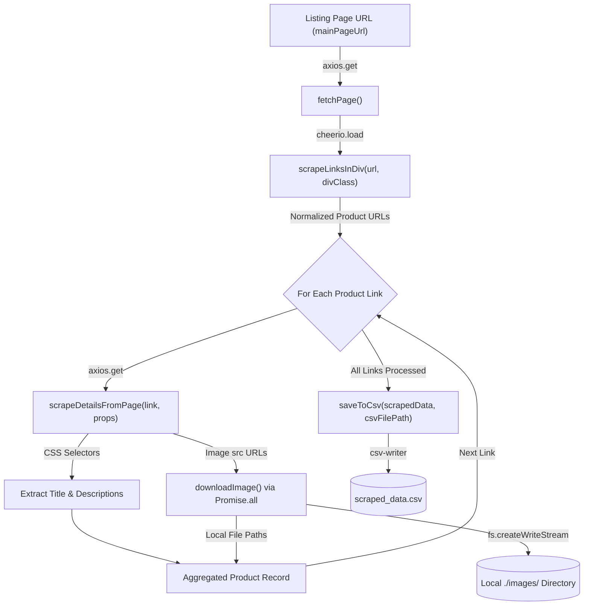

# Products Scrapper

[](https://nodejs.org/)
[](./LICENSE)
[](https://www.conventionalcommits.org/)

A lightweight, configurable Node.js ETL web scraper that extracts product listings, details, descriptions, and image assets from static e-commerce pages, downloads product images locally, and exports structured records to CSV.

---

## Quick Start

Run the scraper locally in 3 steps:

```bash
# 1. Clone the repository
git clone https://github.com/digitalterrene/products-scrapper.git
cd products-scrapper

# 2. Install dependencies
npm install

# 3. Start the interactive API & Swagger UI (test endpoints in browser — no Postman needed)
npm start
# Open http://localhost:3000/docs

# Or run the CLI scraper directly after configuring index.js
npm run scrape
```

### Prerequisites
- **Node.js** `v16+` (v18 or v20 LTS recommended)
- **npm** `v8+`

---

## System Architecture

`products-scrapper` follows a sequential link-discovery and page-extraction pipeline with concurrent per-product image streaming:



### Deep-Dive Documentation (4-Tier Architecture)

| Tier | Document | Purpose |
|---|---|---|
| **Tier 1: Governance** | [CONTRIBUTING.md](./CONTRIBUTING.md), [SECURITY.md](./SECURITY.md), [docs/git-standards.md](./docs/git-standards.md) | Contribution rules, security disclosure, branching & commit standards |
| **Tier 2: Architecture** | [System Design](./docs/architecture/system-design.md) | Component topology, execution flow, and module boundaries |
| **Tier 2: Data Model** | [Data Model & Schemas](./docs/architecture/data-model.md) | Selector contract, in-memory DTOs, CSV schema, and ERDs |
| **Tier 2: Security** | [Security & Scraping Posture](./docs/architecture/security-and-rbac.md) | Threat model, SSRF/path-traversal mitigations, and ethical scraping |
| **Tier 2: API & Swagger** | [API Walkthrough](./docs/api/README.md), [OpenAPI 3.0.3 Spec](./docs/api/openapi.json) | Interactive Swagger UI (`/docs`) and endpoint usage guide |
| **Tier 3: Decisions** | [Architecture Decision Records](./docs/adr/README.md) | Historical rationale for key technical trade-offs (ADRs) |
| **Tier 4: Operations** | [Deployment Verification](./docs/runbooks/deployment-verification.md), [Incident Response](./docs/runbooks/incident-response.md) | Verification checklists and scraping failure triage playbooks |

---

## Repository Structure

```text
products-scrapper/
├── index.js                            # CLI entry point & core scraping functions
├── server.js                           # Express REST API & interactive Swagger UI (/docs)
├── functions/                          # Modular helper functions (standalone/reusable units)
│   ├── fetchPage.js                    # HTTP GET + Cheerio DOM loader
│   ├── scrapeLinksInDivs.js            # Product link extractor from container div
│   ├── scrapeDetailsFromPage.js        # Detail extractor (URL-only image collection)
│   └── saveToCsv.js                    # CSV writer helper
├── docs/
│   ├── api/                            # API walkthrough & OpenAPI 3.0.3 spec (Swagger UI)
│   │   ├── README.md
│   │   └── openapi.json
│   ├── git-standards.md                # Branching, Conventional Commits & hygiene rules
│   ├── architecture/                   # Tier 2: System design, data model, security posture
│   ├── adr/                            # Tier 3: Architecture Decision Records (ADR-000..003)
│   └── runbooks/                       # Tier 4: Verification & incident triage runbooks
├── .github/
│   ├── PULL_REQUEST_TEMPLATE.md        # Standardized PR checklist
│   └── ISSUE_TEMPLATE/                 # Bug report & feature request templates
├── scraped_data.csv                    # Default CSV output target
├── package.json                        # Project manifest & dependencies
├── CONTRIBUTING.md                     # Contributor guide
├── SECURITY.md                         # Security policy & reporting SLAs
└── LICENSE                             # License terms
```

---

## Tech Stack

| Layer | Technology | Version | Role |
|---|---|---|---|
| Runtime | Node.js | `>= 16` | JavaScript execution environment (CommonJS) |
| HTTP Client | `axios` | `^1.7.2` | Fetches HTML documents and streams binary image downloads |
| HTML Parser | `cheerio` | `^1.0.0-rc.12` | Fast CSS-selector-based server-side DOM querying |
| CSV Export | `csv-writer` | `^1.6.0` | Quoted, append-capable CSV record serialization |

---

## Configuration

Open [`index.js`](./index.js) and update the configuration block inside `main()`:

```javascript
const mainPageUrl = "https://example-store.com/products";
const divClass = "products";
const props = {
  titleSelector: ".product-info-main h1",
  shortDescriptionSelector: ".product-info-main div.prose p",
  longDescriptionSelector: "section.product-description .product-info-main p",
  imageSelector: ".product-info-main div img",
};
const csvFilePath = "scraped_data.csv";
```

| Parameter | Type | Description |
|---|---|---|
| `mainPageUrl` | `string` | Base URL of the catalog/listing page containing product links |
| `divClass` | `string` | CSS class name of the `<div>` wrapping product `<a>` tags (`div.${divClass} a`) |
| `props.titleSelector` | `string` | CSS selector targeting the product title element |
| `props.shortDescriptionSelector` | `string` | CSS selector targeting the concise summary element |
| `props.longDescriptionSelector` | `string` | CSS selector targeting full description paragraph(s) (joined with spaces) |
| `props.imageSelector` | `string` | CSS selector targeting product `` elements |
| `csvFilePath` | `string` | Destination path for CSV output (default: `scraped_data.csv`) |

### Output Format

1. **CSV File (`scraped_data.csv`)**: All fields are quoted (`alwaysQuote: true`). Existing files are appended to without duplicating headers.

| URL | Title | Short Description | Long Description | Images |
|---|---|---|---|---|
| `https://.../item-1` | `Widget Pro` | `Compact widget` | `Full product overview...` | `/abs/path/images/img1.jpg, /abs/path/images/img2.jpg` |

2. **Images (`./images/`)**: Downloaded via binary stream using `path.basename(url)` as the filename.

---

## Verification & Hygiene Checks

```bash
# Verify Node.js syntax for all source files
node --check index.js
node --check functions/fetchPage.js
node --check functions/scrapeLinksInDivs.js
node --check functions/scrapeDetailsFromPage.js
node --check functions/saveToCsv.js

# Run repository standards & hygiene audit
node .agents/skills/senior-repo-standards/scripts/audit-hygiene.js
```

---

## Contributing & Security

- Review [CONTRIBUTING.md](./CONTRIBUTING.md) and [docs/git-standards.md](./docs/git-standards.md) before opening a pull request.
- Report security concerns privately following [SECURITY.md](./SECURITY.md).
- Always respect target websites' `robots.txt` directives and Terms of Service.
