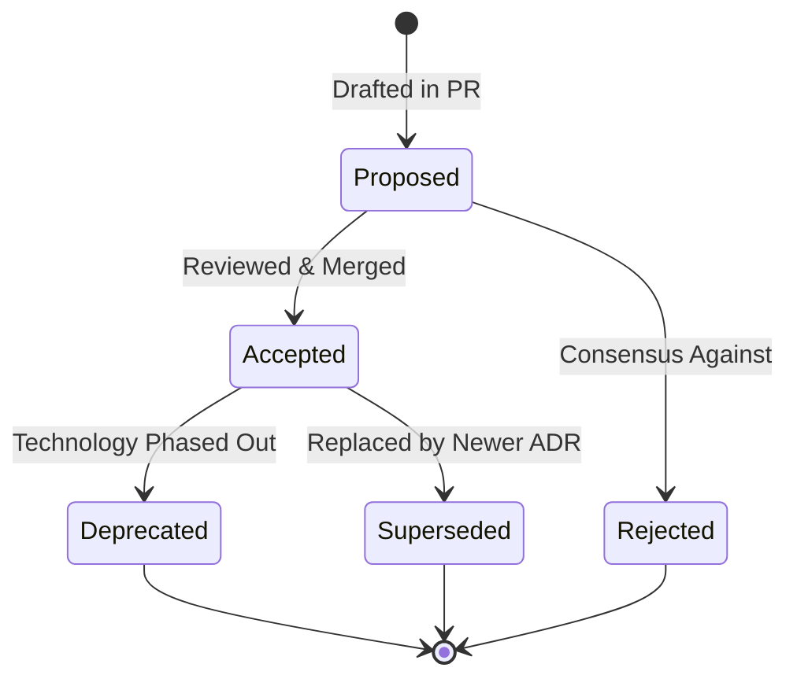

# Architecture Decision Records (ADRs)

This directory contains immutable records of architecturally significant decisions made for **Products Scrapper**.

## ADR Index

| ADR | Title | Status | Date |
|---|---|---|---|
| [ADR-000](./ADR-000-template.md) | Architecture Decision Record Template | Template | 2026-11-22 |
| [ADR-001](./ADR-001-cheerio-axios-static-scraping.md) | Use Axios and Cheerio for Static HTML Scraping | Accepted | 2026-11-22 |
| [ADR-002](./ADR-002-csv-export-and-local-image-streaming.md) | Export Structured Data to Quoted CSV with Local Image Streaming | Accepted | 2026-11-22 |
| [ADR-003](./ADR-003-modular-functions-architecture.md) | Consolidate Monolithic `index.js` and `functions/` Modules | Proposed | 2026-11-22 |
| [ADR-004](./ADR-004-http-api-and-swagger-ui.md) | Expose Local REST API with Built-In Swagger UI for Interactive Testing | Accepted | 2026-11-22 |

---

## ADR Lifecycle

## Creating a New ADR

1. Copy [ADR-000-template.md](./ADR-000-template.md) to `ADR-XXX-short-kebab-title.md`.
2. Fill in Context, Decision, Consequences, and Alternatives Considered.
3. Add a row to the ADR Index table above.
