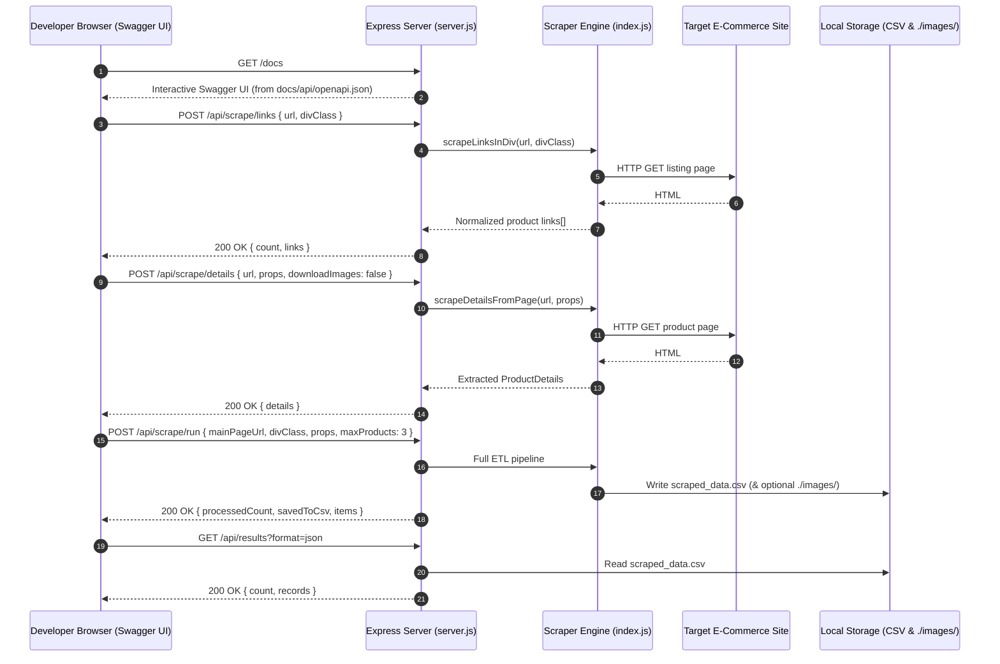

# API Documentation & Interactive Walkthrough

**Products Scrapper** ships with a built-in Express REST API ([`server.js`](../../server.js)) and an interactive **Swagger UI** powered by OpenAPI 3.0.3 ([`openapi.json`](./openapi.json)). Developers can explore every schema and execute live requests directly in the browser — **no Postman or Thunder Client required**.

---

## 1. Launch Interactive API Docs (Zero External Tools)

```bash
# Start the local API server (default port: 3000)
npm start
```

Open your browser to:
- **Interactive Swagger UI**: `http://localhost:3000/docs` *(root `/` redirects here automatically)*
- **Raw OpenAPI 3.0.3 Spec**: `http://localhost:3000/docs/openapi.json`

### How to Test Endpoints Inside Swagger UI
1. Expand any endpoint card (e.g., `POST /api/scrape/links`).
2. Click **Try it out** in the top-right corner of the endpoint panel.
3. Edit the pre-populated JSON request body (or keep the sandbox example pointing at `books.toscrape.com`).
4. Click **Execute** to send the live request and inspect the HTTP status, headers, and formatted JSON response inline.

---

## 2. API Request Lifecycle



---

## 3. Endpoint Reference Overview

| Method | Endpoint | Purpose |
|---|---|---|
| `GET` | `/api/health` | Verify server status, uptime, and Node.js version |
| `POST` | `/api/scrape/links` | Extract normalized product URLs from a listing page container (`div.<divClass> a`) |
| `POST` | `/api/scrape/details` | Dry-run CSS selectors against a single product page (image download optional) |
| `POST` | `/api/scrape/run` | Execute the full discovery -> detail extraction -> CSV export pipeline |
| `GET` | `/api/results` | Read `scraped_data.csv` as JSON rows or download raw CSV (`?format=csv`) |

---

## 4. Step-by-Step Endpoint Walkthrough

### Step 1: Verify the Server (`GET /api/health`)

Confirm the local server is running before testing selectors.

```bash
curl http://localhost:3000/api/health
```

**Response (`200 OK`):**
```json
{
  "status": "ok",
  "service": "products-scrapper",
  "uptimeSeconds": 12,
  "nodeVersion": "v20.11.0",
  "docsUrl": "/docs",
  "openApiUrl": "/docs/openapi.json"
}
```

---

### Step 2: Discover Product Links (`POST /api/scrape/links`)

Validate that your `divClass` selector accurately captures product links on the listing page.

```bash
curl -X POST http://localhost:3000/api/scrape/links \
  -H "Content-Type: application/json" \
  -d '{
    "url": "https://books.toscrape.com/",
    "divClass": "image_container"
  }'
```

**Response (`200 OK`):**
```json
{
  "sourceUrl": "https://books.toscrape.com/",
  "divClass": "image_container",
  "count": 20,
  "links": [
    "https://books.toscrape.com/catalogue/a-light-in-the-attic_1000/index.html",
    "https://books.toscrape.com/catalogue/tipping-the-velvet_999/index.html"
  ]
}
```

---

### Step 3: Dry-Run CSS Selectors (`POST /api/scrape/details`)

Pick one URL returned from Step 2 and test your `props` selectors. Setting `"downloadImages": false` returns resolved image URLs without writing files to `./images/`.

```bash
curl -X POST http://localhost:3000/api/scrape/details \
  -H "Content-Type: application/json" \
  -d '{
    "url": "https://books.toscrape.com/catalogue/a-light-in-the-attic_1000/index.html",
    "downloadImages": false,
    "props": {
      "titleSelector": ".product_main h1",
      "shortDescriptionSelector": ".product_main .price_color",
      "longDescriptionSelector": "#product_description + p",
      "imageSelector": ".item.active img"
    }
  }'
```

**Response (`200 OK`):**
```json
{
  "url": "https://books.toscrape.com/catalogue/a-light-in-the-attic_1000/index.html",
  "downloadImages": false,
  "details": {
    "title": "A Light in the Attic",
    "shortDescription": "£51.77",
    "longDescription": "It's hard to imagine a world without A Light in the Attic...",
    "images": "https://books.toscrape.com/media/cache/fe/72/fe72f0532301ec28892ae79a629a293c.jpg",
    "url": "https://books.toscrape.com/catalogue/a-light-in-the-attic_1000/index.html"
  }
}
```

---

### Step 4: Execute the Full Pipeline (`POST /api/scrape/run`)

Once selectors are verified, run the end-to-end ETL job. Use `maxProducts` during development to test a small slice before scraping an entire catalog.

```bash
curl -X POST http://localhost:3000/api/scrape/run \
  -H "Content-Type: application/json" \
  -d '{
    "mainPageUrl": "https://books.toscrape.com/",
    "divClass": "image_container",
    "downloadImages": false,
    "saveCsv": true,
    "csvFilePath": "scraped_data.csv",
    "maxProducts": 3,
    "props": {
      "titleSelector": ".product_main h1",
      "shortDescriptionSelector": ".product_main .price_color",
      "longDescriptionSelector": "#product_description + p",
      "imageSelector": ".item.active img"
    }
  }'
```

**Response (`200 OK`):**
```json
{
  "mainPageUrl": "https://books.toscrape.com/",
  "totalLinksFound": 20,
  "processedCount": 3,
  "savedToCsv": true,
  "csvFilePath": "scraped_data.csv",
  "items": [ ... ]
}
```

---

### Step 5: Inspect Exported Results (`GET /api/results`)

View exported rows as JSON or download the raw CSV file:

```bash
# JSON rows
curl "http://localhost:3000/api/results?file=scraped_data.csv&format=json"

# Raw CSV download
curl "http://localhost:3000/api/results?file=scraped_data.csv&format=csv"
```

---

## 5. Error Responses

All errors return a consistent JSON structure:

```json
{
  "error": "ValidationError",
  "message": "A valid http:// or https:// 'url' is required."
}
```

| HTTP Status | Error Type | Cause |
|---|---|---|
| `400` | `ValidationError` | Missing/invalid URL, empty `divClass`, invalid `props`, or non-`.csv` filename |
| `404` | `NotFound` | Requested CSV file does not exist in the workspace root |
| `502` | `UpstreamFetchError` | Target website returned an HTTP error (e.g., 403/404/429/500) or timed out |
| `500` | `InternalServerError` | Unexpected runtime or filesystem error |
