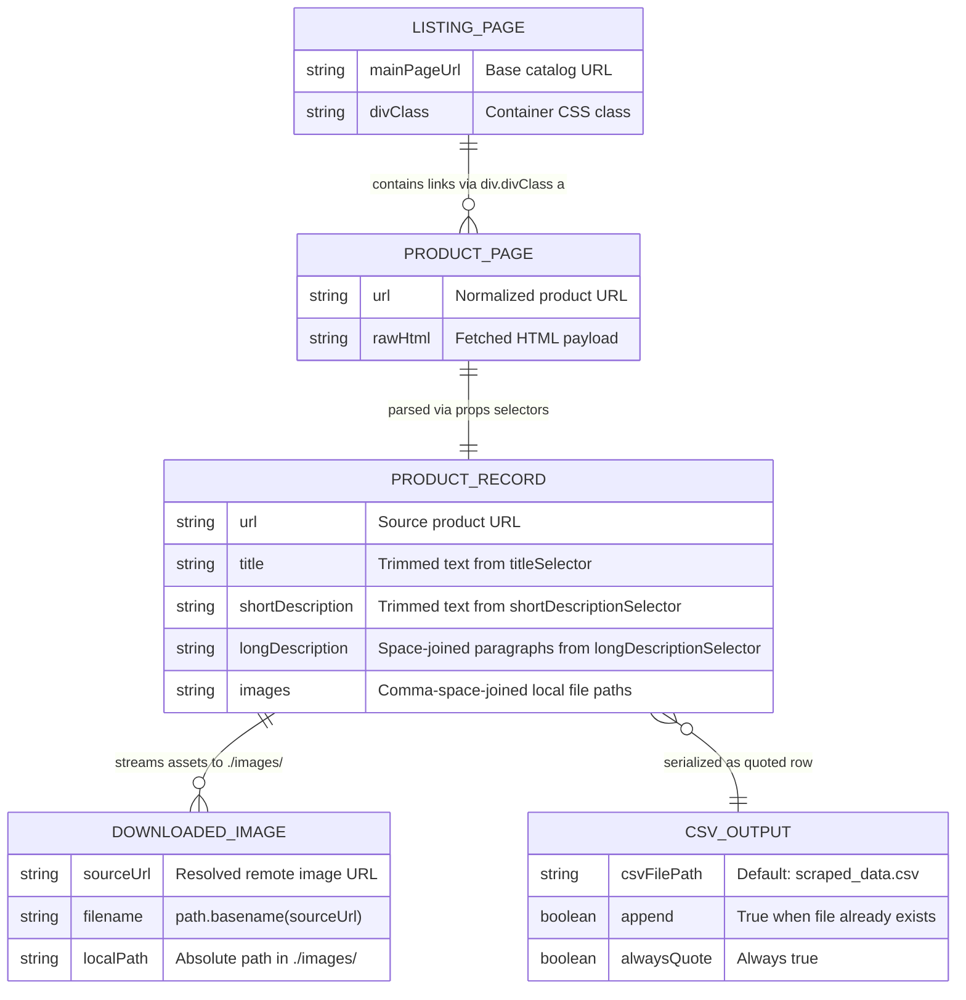
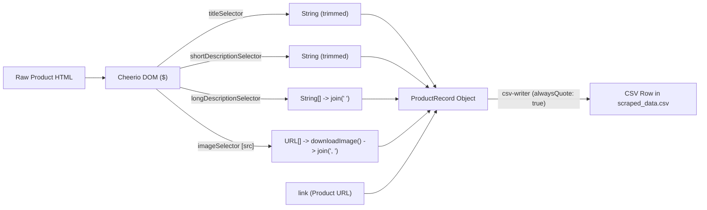

# Data Models & Schemas

- **Status**: Living Architecture Specification
- **Last Updated**: 2026-11-22
- **Scope**: Configuration contracts, in-memory DTOs, CSV export schema, and local image storage

---

## 1. Entity-Relationship Model

Although **Products Scrapper** uses flat-file storage (`scraped_data.csv` and `./images/`) rather than a relational database, its scraped entities follow a strict hierarchical relationship:

---

## 2. Selector Configuration Contract (`props`)

The `props` object passed to `scrapeDetailsFromPage(url, props)` defines optional CSS selectors. Every field is guarded (`if (props.<key>)`), allowing partial extraction when a target site omits certain sections.

| Property | Type | Required | Extraction Logic | Output Field |
|---|---|---|---|---|
| `titleSelector` | `string` | No | `$(selector).text().trim()` | `details.title` |
| `shortDescriptionSelector` | `string` | No | `$(selector).text().trim()` | `details.shortDescription` |
| `longDescriptionSelector` | `string` | No | Iterates all matched elements, trims each, joins with `" "` | `details.longDescription` |
| `imageSelector` | `string` | No | Reads `src` attribute, resolves URL, downloads via `Promise.all`, joins paths with `", "` | `details.images` |

---

## 3. Data Transformation Pipeline

---

## 4. CSV Output Schema (`scraped_data.csv`)

Generated by `csv-writer` (`createObjectCsvWriter`) with `alwaysQuote: true` to safely escape commas, newlines, and quotes inside product descriptions.

| Column Header | Object Key (`id`) | Data Type | Nullable | Example Value |
|---|---|---|---|---|
| `URL` | `url` | `string` (URI) | No | `"https://store.example.com/p/widget"` |
| `Title` | `title` | `string` | Yes | `"Widget Pro 2000"` |
| `Short Description` | `shortDescription` | `string` | Yes | `"Lightweight anodized aluminum widget."` |
| `Long Description` | `longDescription` | `string` | Yes | `"Engineered for precision. Includes 2-year warranty."` |
| `Images` | `images` | `string` (comma-separated paths) | Yes | `"C:\\...\\images\\front.jpg, C:\\...\\images\\side.jpg"` |

### Append Semantics
- **In `index.js`**: `fileExists = fs.existsSync(csvFilePath)` sets `append: fileExists`.
  - If `scraped_data.csv` does **not** exist: writes the header row followed by records.
  - If `scraped_data.csv` **already exists** (even if 0 bytes): sets `append: true`, which omits the header row. Delete an empty `scraped_data.csv` before a fresh run if you want headers written automatically.

---

## 5. Local Asset Storage (`./images/`)

- **Location**: `path.join(__dirname, "images")`
- **Naming Convention**: Extracts `path.basename(new URL(url).pathname)` (stripping query strings such as `?w=800&q=80`) and sanitizes non-alphanumeric characters via `.replace(/[^a-zA-Z0-9._-]/g, "_")`.
- **Dry-Run Mode**: Passing `{ downloadImages: false }` to `scrapeDetailsFromPage()` (or via `POST /api/scrape/details` / `POST /api/scrape/run`) skips disk writes and returns resolved remote image URLs in `details.images`.
- **Known Edge Case**:
  - **Filename Collisions**: Two distinct products referencing `/a/photo.jpg` and `/b/photo.jpg` will still overwrite `images/photo.jpg`. Prefixing filenames with a short URL hash is a future hardening option.

---

## 6. REST API Contracts

The HTTP API ([`server.js`](../../server.js)) exposes typed JSON request/response payloads for every pipeline stage (`ScrapeLinksRequest`, `ScrapeDetailsRequest`, `ScrapeRunRequest`, `ResultsResponse`, `ErrorResponse`).

- **Authoritative Schema**: [`docs/api/openapi.json`](../api/openapi.json) (OpenAPI 3.0.3)
- **Interactive Walkthrough**: [`docs/api/README.md`](../api/README.md)

