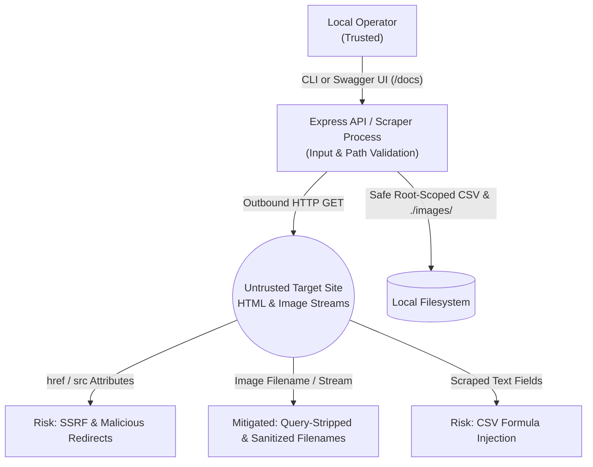

# Security Architecture & Ethical Scraping Posture

- **Status**: Living Architecture Specification
- **Last Updated**: 2026-11-22
- **Scope**: Threat surface, input/URL handling, filesystem safety, secret hygiene, and ethical scraping controls

---

## 1. Security Boundary & Trust Model

**Products Scrapper** operates as a local CLI utility (`index.js`) and an optional local developer REST API (`server.js`, default `PORT=3000`, Swagger UI at `/docs`). It does not implement user authentication or multi-tenant RBAC and is designed for **local/trusted-network developer execution**.

Its primary security boundaries exist between:
1. **Local API requests** and filesystem persistence (`csvFilePath`, `file` query parameter).
2. **Untrusted external web content** (HTML attributes, HTTP redirects, image streams) and the local host filesystem & network.



---

## 2. Threat Analysis & Mitigations

| Threat Vector | Description | Current Behavior | Recommended Hardening |
|---|---|---|---|
| **API Path Traversal (`csvFilePath` / `file`)** | Malicious API callers passing `../../etc/passwd` or arbitrary write paths to `/api/scrape/run` or `/api/results`. | **Mitigated in `server.js`**: `resolveSafeCsvPath()` enforces `path.basename()` + `.csv` suffix, pinning reads/writes to the workspace root; JSON body capped at `1mb`. | Maintain strict basename allowlisting if multi-directory exports are added later. |
| **CSV Formula Injection** | Product titles/descriptions starting with `=`, `+`, `-`, or `@` may execute as formulas when opened in spreadsheet software (Excel/Calc). | `csv-writer` quotes values (`alwaysQuote: true`) but does not neutralize leading formula characters. | Prefix values starting with `[=+\-@]` with a single quote (`'`) or tab before export if CSVs are opened in Excel. |
| **SSRF / Untrusted Redirects** | `axios` follows HTTP 3xx redirects by default. API callers or malicious `href`/`src` links could target internal network addresses (`127.0.0.1`, `169.254.169.254`). | `server.js` validates `http:`/`https:` protocol via `isValidHttpUrl()`, but does not block private IP ranges. | Do not expose `server.js` publicly without adding authentication, rate limiting, and a domain/IP allowlist. |
| **Filesystem / Filename Edge Cases** | Query strings (`?v=1`) or special characters in image URLs causing invalid Windows filenames. | **Mitigated in `index.js`**: Extracts `path.basename(new URL(url).pathname)` and sanitizes characters via `[^a-zA-Z0-9._-]`. | Enforce `maxContentLength` and request `timeout` on Axios image streams. |
| **Unbounded Disk / Memory Growth** | Large or infinite image streams could exhaust local disk space; large catalogs accumulate all records in memory (`scrapedData[]`) before writing. | API supports `maxProducts` cap and `downloadImages: false` for bounded runs; no Axios timeout/size cap yet. | Add `timeout: 15000` and `maxContentLength` on `axios` requests; flush CSV rows incrementally. |
| **Secret & Credential Leakage** | If authentication cookies, API tokens, or proxy credentials are added for private catalogs, hardcoding them risks VCS leaks. | `.gitignore` blocks `.env`, `.env.*`, `*.pem`, `*.key`, and `*credentials*.json`. | Load all secrets exclusively via `process.env` and document keys in `.env.example`. |

---

## 3. Ethical Scraping & Compliance Controls

To ensure responsible operation:
1. **Respect `robots.txt` & Terms of Service**: Verify that automated access to the target domain is permitted before running the scraper.
2. **Identify Traffic Transparently**: Configure a clear `User-Agent` header when scraping partner or authorized sites.
3. **Avoid Denial-of-Service Patterns**: Keep page crawling sequential or strictly concurrency-limited, and add inter-request delays (`setTimeout`) for large catalogs.
4. **Data Privacy**: Do not scrape Personally Identifiable Information (PII) without explicit legal basis and authorization.

---

## 4. Dependency & Supply-Chain Hygiene

Run periodic audits on Node.js dependencies (`axios`, `cheerio`, `csv-writer`):

```bash
npm audit
```

Report security vulnerabilities privately per [SECURITY.md](../../SECURITY.md).
