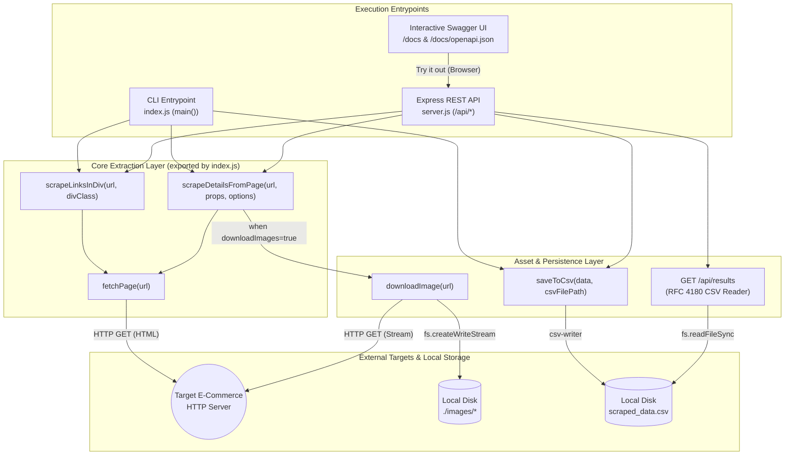
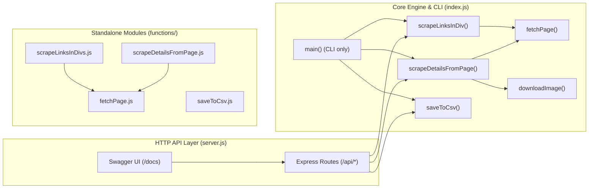

# System Design & Component Topology

- **Status**: Living Architecture Specification
- **Last Updated**: 2026-11-22
- **Scope**: Dual-mode scraping architecture — CLI pipeline (`index.js`), Express REST API + Swagger UI (`server.js`), and standalone helpers (`functions/*`)

---

## 1. Architectural Overview

**Products Scrapper** is a Node.js Extract-Transform-Load (ETL) application that harvests structured product metadata and binary image assets from static HTML e-commerce storefronts. It supports two execution modes backed by the same core scraping primitives exported from [`index.js`](../../index.js):

- **CLI Mode (`npm run scrape` / `node index.js`)**: Runs `main()` directly using the static configuration block.
- **Interactive API & Swagger UI Mode (`npm start` / `node server.js`)**: Exposes REST endpoints (`/api/*`) and a bundled OpenAPI 3.0.3 Swagger UI (`/docs`) for zero-client browser testing and selector dry-runs.

Both modes execute the same three deterministic phases:
1. **Discovery (Extract Links)**: Fetches a catalog listing page (`mainPageUrl`) and extracts all product page hyperlinks matching `div.${divClass} a`, resolving relative URLs via `new URL(link, url).href`.
2. **Detail Extraction & Asset Streaming (Transform)**: Sequentially visits each discovered product URL, parses DOM nodes via Cheerio CSS selectors, and optionally streams matched `` assets concurrently to local disk (`./images/`) with sanitized filenames.
3. **Persistence (Load)**: Serializes aggregated product records into a quoted CSV file (`scraped_data.csv`), appending to existing files without duplicating headers.

---

## 2. High-Level Component Topology



---

## 3. End-to-End Execution Sequence

The scraper processes product pages **sequentially** (to reduce request bursts on the target server), while downloading images **concurrently** per product page using `Promise.all`.

```mermaid
sequenceDiagram
    autonumber
    participant Main as main()
    participant Links as scrapeLinksInDiv()
    participant Fetch as fetchPage()
    participant Details as scrapeDetailsFromPage()
    participant Img as downloadImage()
    participant Web as Target Website
    participant Disk as Local Filesystem
    participant CSV as saveToCsv()

    Main->>Links: scrapeLinksInDiv(mainPageUrl, divClass)
    Links->>Fetch: fetchPage(mainPageUrl)
    Fetch->>Web: GET mainPageUrl
    Web-->>Fetch: 200 OK (Listing HTML)
    Fetch-->>Links: Cheerio DOM ($)
    Links-->>Main: links[] (normalized URLs)

    loop For each link in links[]
        Main->>Details: scrapeDetailsFromPage(link, props)
        Details->>Fetch: fetchPage(link)
        Fetch->>Web: GET link
        Web-->>Fetch: 200 OK (Product HTML)
        Fetch-->>Details: Cheerio DOM ($)
        Details->>Details: Extract title, shortDescription, longDescription

        par Concurrent image downloads (Promise.all)
            Details->>Img: downloadImage(imgURL_1)
            Img->>Web: GET imgURL_1 (responseType: stream)
            Web-->>Img: Binary image stream
            Img->>Disk: Pipe to ./images/<basename>
            Img-->>Details: imgPath_1
        and
            Details->>Img: downloadImage(imgURL_N)
            Img->>Web: GET imgURL_N (responseType: stream)
            Web-->>Img: Binary image stream
            Img->>Disk: Pipe to ./images/<basename>
            Img-->>Details: imgPath_N
        end

        Details-->>Main: details { title, shortDescription, longDescription, images }
        Main->>Main: Attach details.url = link & push to scrapedData[]
    end

    Main->>CSV: saveToCsv(scrapedData, csvFilePath)
    CSV->>Disk: Check fs.existsSync(csvFilePath)
    CSV->>Disk: Write/Append quoted CSV records
    CSV-->>Main: Done
```

---

## 4. Module Structure & Current Divergence (`index.js`, `server.js`, and `functions/`)

- **`index.js`** (Core Engine & CLI): Exports `fetchPage`, `scrapeLinksInDiv`, `scrapeDetailsFromPage`, `downloadImage`, `saveToCsv`, and `main`. Auto-runs `main()` only when invoked directly (`require.main === module`).
- **`server.js`** (REST API & Swagger UI): Imports the exported scraping primitives from `index.js`, adds request validation, safe CSV path enforcement, RFC 4180 CSV reading, and mounts `swagger-ui-express` at `/docs` using [`docs/api/openapi.json`](../api/openapi.json).
- **`functions/`** (Standalone Modules): Four exported CommonJS modules (`fetchPage.js`, `scrapeLinksInDivs.js`, `scrapeDetailsFromPage.js`, `saveToCsv.js`) representing an earlier modularization pass.



### Behavioral Comparison

| Capability | `index.js` & `server.js` (Active) | `functions/` (Standalone) |
|---|---|---|
| Relative URL normalization (`href`, `src`) | Resolves via `new URL(link, baseUrl).href` | Returns raw `href` / `src` attributes |
| Image handling | Optional via `{ downloadImages }` (streams sanitized filenames to `./images/` or returns resolved URLs) | Collects raw `src` strings only (no download) |
| CSV append behavior | `append: fs.existsSync(csvFilePath)` | Always `append: true` |

> See [ADR-003: Modular Functions Architecture](../adr/ADR-003-modular-functions-architecture.md) and [ADR-004: HTTP API & Swagger UI](../adr/ADR-004-http-api-and-swagger-ui.md) for architectural context.

---

## 5. Error Handling & Resilience Characteristics

- **Fail-Fast Top-Level Catch**: `main()` wraps the entire crawl and export loop in a single `try / catch` block. Any unhandled network failure (e.g., `ECONNRESET`, HTTP 404/429/500) or stream write error aborts the run before `saveToCsv()` is called.
- **No Built-In Rate Throttling or Retries**: Requests fire immediately back-to-back. For large catalogs, introducing per-request delays and exponential backoff retries is recommended.
- **Synchronous Directory Bootstrap**: `downloadImage()` checks `fs.existsSync(imagesDir)` and calls `fs.mkdirSync(imagesDir)` lazily on the first download.
