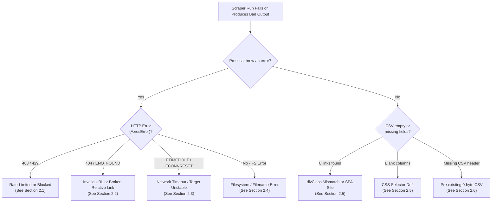

# Incident Response & Scraping Failure Triage Runbook

- **Status**: Operational Runbook
- **Last Updated**: 2026-11-22
- **Audience**: Developers, Operators, On-Call Engineers

---

## 1. Failure Triage Flowchart

---

## 2. Incident Remediation Playbooks

### 2.1 HTTP 403 Forbidden / 429 Too Many Requests
- **Symptom**: `AxiosError: Request failed with status code 403` or `429`.
- **Root Cause**: Target server rate-limiting, missing `User-Agent` header, or WAF/bot protection.
- **Remediation**:
  1. Verify scraping is permitted in the target site's `robots.txt`.
  2. Add a realistic `User-Agent` header to `axios.get(url, { headers: { "User-Agent": "..." } })`.
  3. Insert a delay between product page requests inside the `for (const link of links)` loop in `index.js` (e.g., `await new Promise((r) => setTimeout(r, 1000))`).

### 2.2 HTTP 404 or `ERR_INVALID_URL`
- **Symptom**: `Invalid URL` or `404` on product pages or image downloads.
- **Root Cause**: `mainPageUrl` is still set to the placeholder `"mainPageUrl"`, or naive string concatenation (`url + link`) produced a malformed URL (e.g., `https://site.com/category/item` concatenated with `/p/123` -> `https://site.com/category/item/p/123`).
- **Remediation**:
  1. Confirm `mainPageUrl` includes protocol (`https://`).
  2. Replace `link.startsWith("http") ? link : url + link` with `new URL(link, url).href`.

### 2.3 Network Timeouts (`ETIMEDOUT` / `ECONNRESET`)
- **Symptom**: Scraper hangs indefinitely or aborts mid-crawl, losing all previously scraped items in `scrapedData[]`.
- **Root Cause**: `axios` has no default timeout and `main()` only calls `saveToCsv()` after the entire loop completes.
- **Remediation**:
  1. Configure `timeout: 15000` in Axios calls.
  2. Wrap individual product iterations in `try / catch` so one failed product logs a warning instead of aborting the entire batch.

### 2.4 Filesystem Errors (`ENOENT` / `EINVAL` during `downloadImage`)
- **Symptom**: `fs.createWriteStream` fails on Windows with `ENOENT` or invalid argument.
- **Root Cause**: Image URL contains query parameters (`image.jpg?w=800&fmt=webp`) that contain illegal filename characters (`?`, `&`, `=`).
- **Remediation**:
  1. Extract the clean filename using `path.basename(new URL(url).pathname)`.
  2. Verify write permissions on the repository directory.

### 2.5 Empty CSV or Blank Columns
- **Symptom**: Scraper exits with `Data has been scraped and saved to CSV file.`, but `scraped_data.csv` has 0 rows or empty cells.
- **Root Cause**:
  - `div.${divClass} a` matched 0 elements (wrong `divClass` or JavaScript-rendered SPA).
  - Target site changed HTML class names (selector drift).
- **Remediation**:
  1. Inspect the raw HTML returned by `axios.get(mainPageUrl)` (not DevTools' post-JS DOM) to confirm the data exists in static HTML.
  2. Update `divClass` and `props` selectors in `index.js`.

### 2.6 Missing CSV Header Row
- **Symptom**: `scraped_data.csv` contains data rows but no `URL,Title,...` header on line 1.
- **Root Cause**: `scraped_data.csv` already existed as a 0-byte file, causing `fs.existsSync(csvFilePath)` to set `append: true`.
- **Remediation**:
  1. Delete the empty `scraped_data.csv` before running `npm run scrape` or `POST /api/scrape/run`.

### 2.7 API Server Port Conflict (`EADDRINUSE`) or Validation Errors (`400` / `502`)
- **Symptom**: `npm start` fails with `EADDRINUSE :::3000`, or Swagger UI returns `400 ValidationError` / `502 UpstreamFetchError`.
- **Remediation**:
  1. **Port conflict**: Start the server on another port:
     - PowerShell: `$env:PORT=4000; npm start`
     - Bash/macOS/Linux: `PORT=4000 npm start`
  2. **`400 ValidationError`**: Ensure `url` / `mainPageUrl` starts with `http://` or `https://`, `divClass` is a non-empty string, `props` is a JSON object, and `csvFilePath` ends with `.csv`.
  3. **`502 UpstreamFetchError`**: Check `upstreamStatus` in the JSON error response and follow Sections 2.1–2.3 above.
  4. **`404 NotFound` on `GET /api/results`**: Run `POST /api/scrape/run` with `"saveCsv": true` first, or verify the `file` query parameter matches a `.csv` file in the workspace root.
